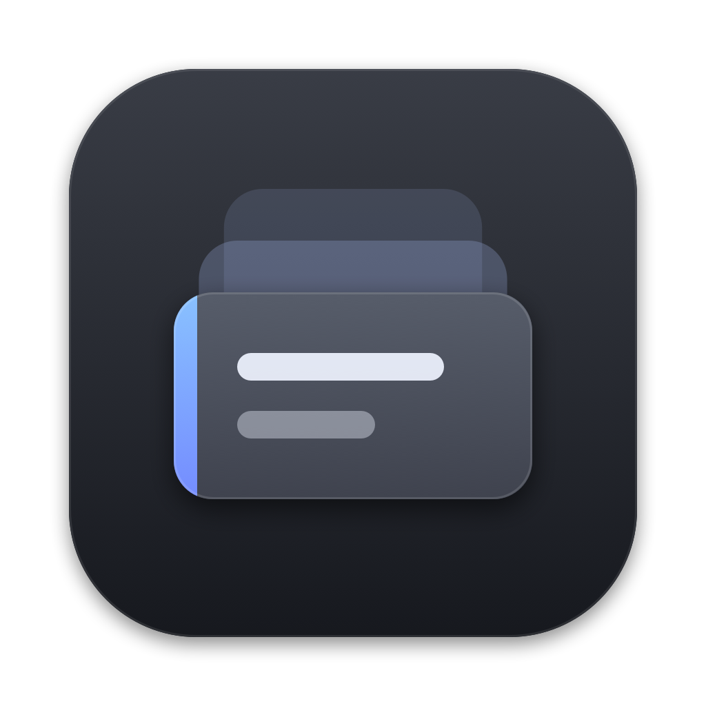

# Kopi

**A clipboard manager for macOS: CopyClip 2's features in a small menu-bar dropdown that doesn't hurt to look at.**

CopyClip 2 works, but its UI is rough. Kopi keeps every behaviour worth keeping (menu-bar dropdown, ⌃Space, ⌘1–⌘0 quick paste, pins, direct paste, app ignore list) and replaces the chrome: compact dark rows, source-app icons, filter chips, instant fuzzy search with highlights, a quick preview on Space and a proper edit sheet.

<p align="center"></p>

## Features
- Menu-bar dropdown panel (⌃Space) and a compact pop-up menu at the mouse pointer (⌃⇧Space).
- Fuzzy search across your whole history with highlighted matches and filter chips.
- **⌘1–⌘0** paste the first ten rows; ↩ pastes, ⇧↩ pastes as plain text.
- **Direct paste** into the app you were in (needs Accessibility permission).
- Pins (never count toward the history limit), edit clip with an optional name, delete, Make Plain Text, Open Link.
- Quick preview on Space, side preview pane on ⌘\\.
- History limit up to 9,999 clips, stored in SQLite.
- Ignores password managers and secure fields, plus your own ignored-apps list. Pause recording any time.
- **Imports your CopyClip 2 history** on first launch (from a read-only temp copy, so a running CopyClip is never touched) and carries over its shortcuts.
- Themes: Graphite, Midnight, Forest, Rose, Black, Light.
- Start at login.

## Requirements
- macOS 14 or later
- Xcode command-line tools (`xcode-select --install`) for Swift
- Accessibility permission for direct paste (macOS asks; Settings → Grant…)

## Install
```bash
git clone https://github.com/MelvernMogens/kopi.git
cd kopi
scripts/make-signing-identity.sh   # once: stable local signing identity so the Accessibility grant survives rebuilds
scripts/build-app.sh --install     # builds, signs, copies to /Applications and launches
```
Kopi lives in the menu bar (no Dock icon). To update later: `git pull && scripts/build-app.sh --install`.

## Shortcuts
| Keys | Action |
|---|---|
| ⌃Space / ⌃⇧Space | Panel / pop-up menu (CopyClip's defaults, changeable in Settings) |
| ↑↓ · ↩ | Navigate · paste (⇧↩ plain text) |
| ⌘1–⌘0 | Paste that row |
| Space | Full-clip preview · ⌘\\ side preview pane |
| ⌘P · ⌘E · ⌘⌫ | Pin · edit · delete |
| ⇥ | Cycle filter chips |

## How it works
```
NSPasteboard (poll 0.35s changeCount) ─▶ ClipboardMonitor ─▶ SQLite (WAL)
                                                              │
⌃Space / menu-bar icon ─▶ PanelController (NSPanel, dropdown)─┘
Enter / ⌘1-0 ─▶ pasteboard write + CGEvent ⌘V into previous app
CopyClip 2 copyclip.sqlite ──(read-only temp copy)──▶ import on first launch
```
- `KopiKit`: pure logic (clip store, search, rules, CopyClip importer, SQLite via the C API), unit-tested.
- `Kopi`: AppKit panel + SwiftUI views, Carbon global hotkeys, CGEvent paste.
- Zero third-party dependencies. History lives in `~/Library/Application Support/Kopi/kopi.sqlite`.

## Development
```bash
swift build
swift test          # KopiKit tests
KOPI_DEBUG=1 /Applications/Kopi.app/Contents/MacOS/Kopi   # log panel state when chasing focus bugs
```

## Status
Personal tool shared with friends. Self-signed, not sandboxed, not notarized. Text and rich text only for now; image and file clips are on the backlog (see [`docs/prd.md`](docs/prd.md)).

Built by [Melvern Mogens](https://github.com/MelvernMogens).
